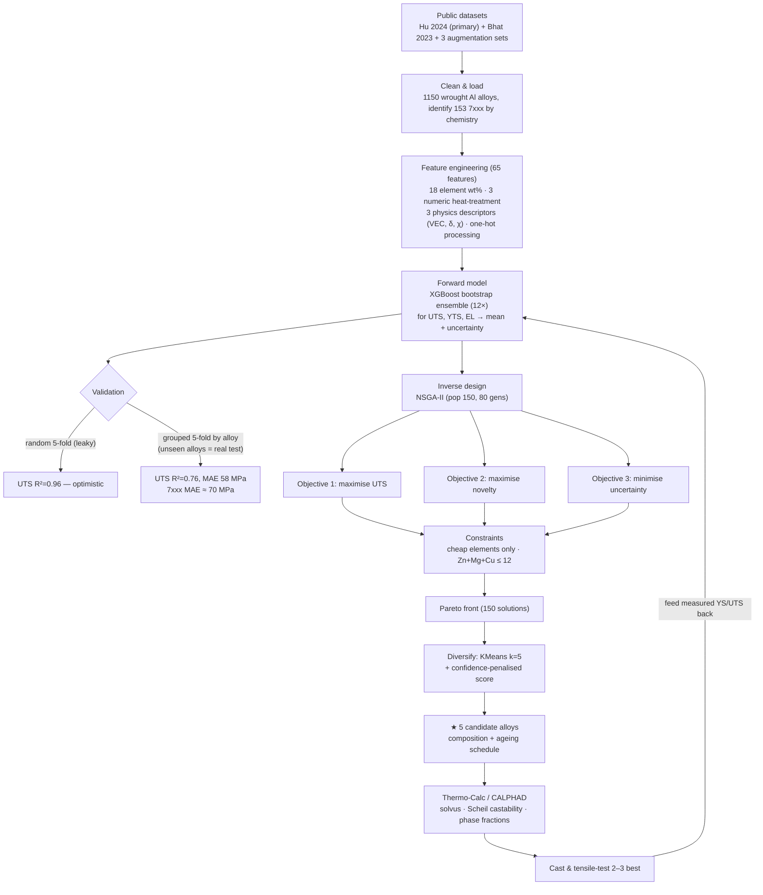

# ML-Driven Design of High-Strength 7xxx Aluminium Alloys

An end-to-end, reproducible machine-learning pipeline that learns how composition **and
heat-treatment** control the strength of wrought aluminium alloys, then **inverse-designs new
7xxx (Al-Zn-Mg-Cu) compositions** predicted to exceed 7075-T6 — using only **cheap, common
foundry elements** (no Sc, Zr, Ti or other rare/expensive additions).

The output is a short list of candidate alloys (composition + ageing schedule) intended to be
screened in **Thermo-Calc (CALPHAD)** and then **cast and mechanically tested**, with the
measured results fed back to retrain the model (active learning).

---

## 🔬 Headline result — 5 candidates using only Zn, Mg, Cu, Mn, Cr

Predicted with an XGBoost ensemble; **predictions carry a realistic ±~70 MPa band** (see
[Performance](#4-performance--how-we-tested-it)). All are predicted above 7075-T6 (≈572 MPa).

| # | Zn | Mg | Cu | Mn | Cr | Heat treatment | Pred. UTS | Pred. YTS | EL % | Novelty | Character |
|---|----|----|----|----|----|----------------|:---------:|:---------:|:----:|:-------:|-----------|
| 1 | 7.3 | 2.6 | 2.1 | 0.01 | 0.16 | SHT 460 °C → water quench → age 106 °C / 25 h | **635** | 576 | 13 | 1.7 | Optimised 7050/7150-type — **highest confidence** |
| 2 | 7.3 | 1.2 | 2.5 | 0.40 | 0.28 | SHT 463 °C → WQ → age 103 °C / 25 h | **616** | 552 | 15 | 3.7 | High Mn+Cr dispersoids, Cu-rich |
| 3 | 9.4 | 1.8 | 0.5 | 0.01 | 0.13 | SHT 463 °C → WQ → age 108 °C / 25 h | **614** | 543 | 15 | 3.2 | High-Zn **lean-Cu** (better weldability / SCC) |
| 4 | 8.9 | 2.6 | 0.4 | 0.37 | 0.10 | SHT 467 °C → WQ → age 114 °C / 24 h | **596** | 552 | 14 | 2.8 | High Zn+Mg, low Cu |
| 5 | 5.7 | 2.6 | 2.6 | 0.03 | 0.12 | SHT 460 °C → WQ → age 120 °C / 24 h | **590** | 546 | **20** | 1.7 | Leaner Zn — **excellent strength + ductility** |

*Units: wt %; strength in MPa. SHT = solution heat treatment. Full machine-readable output:
[`data/candidates_cheap.csv`](data/candidates_cheap.csv).*

> A version that **allows** Sc/Zr/Ti reaches ~660 MPa (+25 MPa) — see
> [`data/candidates.csv`](data/candidates.csv) and [Appendix](#appendix--rare-element-variant).
> The 25 MPa premium was judged not worth the rare-metal cost/availability.

---

## 🗺️ Process flow



---

## 1. Data

| File | Source | Rows | Why used |
|------|--------|-----:|----------|
| `data/hu2024_dataset.xlsx` | Hu et al. 2024, *Comput. Mater. Sci.* 244:113204 ([GitHub](https://github.com/UQ43815685/mitigating_data_bias_for_Al_alloys_design)) | 1150 | **Primary** — has *numeric* solution/ageing temperature & time (feeds CALPHAD) |
| `data/bhat2023_al_data.csv` | Bhat, Barnard & Birbilis 2023 ([Mendeley, DOI 10.17632/b6br4yk6r3.1](https://doi.org/10.17632/b6br4yk6r3.1), CC-BY-4.0) | 1154 | Clean-licence corroborator |
| `data/cstg_origin1293.xlsx`, `data/haoyun_*.xlsx` | GitHub age-hardenable Al compilations | 1292 / 524 / 320 | Augmentation (next iteration) |

Each row links **composition → processing/heat-treatment → mechanical properties (YTS, UTS,
elongation)**. The model was trained on all 1150 wrought alloys; **7xxx alloys (153)** were
identified by chemistry (Zn ≥ 3 wt % and Zn the dominant alloying element) and used as the
inverse-design target region. Full provenance & licences: [`data/DATA_SOURCES.md`](data/DATA_SOURCES.md).

> ⚠️ The raw third-party datasets are **not redistributed** in this repo (no redistribution
> licence). Download them with the commands in `data/DATA_SOURCES.md`.

## 2. Features (65 total)

- **18 alloying elements** (wt %): Si, Fe, Cu, Mn, Mg, Cr, Zn, V, Ti, Zr, Li, Ni, Ga, Bi, Pb, B, Be, Sc (Al = balance).
- **3 numeric heat-treatment** variables: solution/annealing temperature, ageing temperature, ageing time.
- **3 physics descriptors** computed from atomic fractions: valence-electron concentration (**VEC**),
  mean Pauling **electronegativity**, and atomic-**size-mismatch δ**.
- **One-hot processing**: manufacturing method, quench medium, strain-hardening, ageing type, post-treatment, product shape.

## 3. Forward model — how we trained it

- **Algorithm:** `XGBoost` regressor — `n_estimators=600, max_depth=5, learning_rate=0.03,
  subsample=0.8, colsample_bytree=0.8, min_child_weight=3`. Separate models for UTS, YTS, EL.
- **Uncertainty:** a **12-member bootstrap ensemble** per target. The ensemble **mean** is the
  prediction; the **standard deviation** is the model-confidence estimate used in inverse design.
- Script: [`forward_model.py`](forward_model.py) → saves `models.pkl`.

## 4. Performance — how we tested it

Two cross-validation schemes, because they tell very different stories:

| Target | Random 5-fold *(leaky)* | **Grouped 5-fold** *(unseen alloys — the honest test)* | 7xxx subset (grouped) |
|--------|:----------------------:|:-----------------------------------------------------:|:---------------------:|
| **UTS** | R² 0.965 · MAE 18 MPa | **R² 0.755 · MAE 58 MPa** | R² 0.33 · MAE 70 MPa |
| **YTS** | R² 0.944 · MAE 22 MPa | **R² 0.715 · MAE 58 MPa** | R² 0.57 · MAE 72 MPa |
| **EL**  | R² 0.730 · MAE 2.5 %  | **R² ≈ 0 (not predictable)** | negative |

**Why grouped CV matters:** random splits let the model memorise alloys that appear in both
train and test, inflating R² to ~0.96. Grouping by alloy (62 distinct groups) forces prediction
on *genuinely unseen* chemistries — the real discovery setting — where UTS R² is ~0.76 and the
honest error band is **±~70 MPa on 7xxx**. **Elongation is not reliably predictable**, so it is
reported but **not** used as an optimisation objective.

**Top feature importances (UTS):** water-quench, ageing time, Cu, size-mismatch δ, ageing type,
Zn, Mg — all metallurgically expected 7xxx strengthening levers, a sanity check that the model
learned physics rather than noise.

## 5. Inverse design — how we found new compositions

[`inverse_design_cheap.py`](inverse_design_cheap.py) — **NSGA-II** multi-objective genetic
algorithm (`pymoo`, population 150, 80 generations) searching over composition + ageing schedule:

- **Search variables (cheap elements only):** Zn [4–9.5], Mg [1–3], Cu [0–2.6], Mn [0–0.4],
  Cr [0–0.28] wt %; solution T [460–490 °C], ageing T [100–150 °C], ageing time [8–48 h].
  Fe ≤ 0.15, Si ≤ 0.10 (impurities); **Sc, Zr, Ti, V, Li, Ni, Be … all fixed to 0**.
- **Fixed processing** (what the lab can do): extruded, water-quenched, artificially aged.
- **Three objectives:** maximise predicted **UTS**, maximise **novelty**, minimise prediction
  **uncertainty**.
- **Manufacturability constraint:** Zn + Mg + Cu ≤ 12 wt % (limits hot-tearing / quench sensitivity).

## 6. Novelty — how it is defined

For each candidate, **novelty = the minimum standardised Euclidean distance** to *every* training
7xxx alloy, measured in the `[Zn, Mg, Cu, Mn, Cr + 3 heat-treatment]` space (each axis z-scored by
the training-7xxx mean and standard deviation). Novelty ≈ 1.5–2 means "an optimised tweak of a
known alloy" (high confidence); novelty ≳ 3.5 means "a genuinely different chemistry" (more
upside, more risk). This is the same idea used by Hu et al. 2024 to push designs beyond the
existing data.

## 7. Candidate selection

From the 150-point Pareto front: **KMeans (k = 5)** on the standardised design variables groups the
front into 5 distinct families; within each family the member with the highest
**confidence-penalised score** `score = UTS_mean − 0.5 × UTS_std` is chosen. This yields **5
diverse** candidates rather than 5 near-duplicates of one corner.

## 8. Limitations (read before casting)

1. **Predictions are hypotheses, not measurements** — trust the ±~70 MPa band, not the tight
   ensemble spread.
2. **No grain-refiner (Zr/Ti) in the cheap set** — grain-structure control now depends on Mn/Cr
   dispersoids **and your deformation step** (extrusion/rolling); the composition→strength model
   does not see grain size directly, so absolute strength may be slightly optimistic for an
   un-refined ingot.
3. **Castability is not yet checked** — that is the job of the Thermo-Calc step (candidates 1 & 5
   sit near the Zn+Mg+Cu ceiling and are the riskiest to pour soundly).
4. **7xxx data is thin** (153 alloys, ~few dozen distinct chemistries) — pooling the augmentation
   sets is the most effective next improvement.

## 9. Next steps

- **Thermo-Calc each candidate:** solvus vs. solution temperature; Scheil freezing range
  (castability); equilibrium phase fractions at the ageing temperature (confirm η′/MgZn₂).
- Cut to the 2–3 most castable, **cast & tensile-test**, and feed results back into
  `forward_model.py` to start the active-learning loop.

---

## Repository structure

```
.
├── README.md                 # this file
├── eda.py                    # exploratory data analysis
├── poc.py                    # feasibility proof on the original (unlinked) dataset
├── forward_model.py          # train + cross-validate the XGBoost ensemble  → models.pkl
├── inverse_design.py         # NSGA-II (all elements allowed)
├── inverse_design_cheap.py   # NSGA-II (cheap common elements only)         → headline result
└── data/
    ├── DATA_SOURCES.md       # dataset provenance, licences, re-download commands
    ├── candidates_cheap.csv  # ★ 5 cheap-element candidates
    └── candidates.csv        # rare-element variant (Sc/Zr/Ti allowed)
```

## Reproduce

```bash
pip install pandas numpy scikit-learn xgboost pymoo scipy openpyxl
# download datasets per data/DATA_SOURCES.md, then:
python3 forward_model.py        # trains + prints CV metrics, writes models.pkl
python3 inverse_design_cheap.py # writes data/candidates_cheap.csv
```

## Appendix — rare-element variant

If Sc/Zr/Ti are available, [`data/candidates.csv`](data/candidates.csv) lists the unconstrained
optima (top UTS ≈ 660 MPa). Generated by [`inverse_design.py`](inverse_design.py).

## References

- Hu et al. (2024) *Comput. Mater. Sci.* **244**, 113204.
- Bhat, Barnard & Birbilis (2023) Mendeley Data, DOI 10.17632/b6br4yk6r3.1.
- Li et al. (2020) *Commun. Mater.* **1**, 73 (ML-discovered 7xxx, UTS 952 MPa).
- Pfeiffer et al. (2022) *Sci. Data* **9**, 128 (the original composition corpus).

---

*Pipeline built with Python (pandas, scikit-learn, XGBoost, pymoo). Predictions are
computational estimates requiring thermodynamic and experimental validation.*
