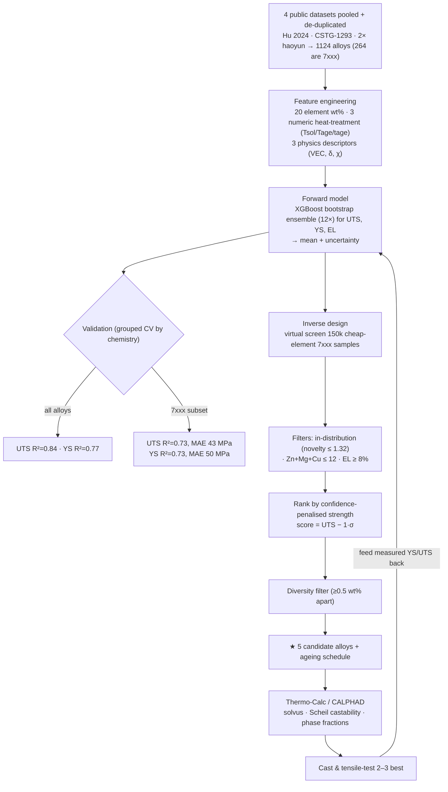

# ML-Driven Design of High-Strength 7xxx Aluminium Alloys

An end-to-end, reproducible machine-learning pipeline that learns how composition **and
heat-treatment** control the strength of wrought aluminium alloys, then **inverse-designs new
7xxx (Al-Zn-Mg-Cu) compositions** predicted to match or beat 7075/7055 — using only **cheap,
common foundry elements** (no Sc, Zr, Ti or other rare/expensive additions).

The output is a short list of candidate alloys (composition + ageing schedule) to be screened in
**Thermo-Calc (CALPHAD)** and then **cast and mechanically tested**, with measured results fed
back to retrain the model (active learning).

---

## 🔬 Headline result — 5 candidates using only Zn, Mg, Cu, Mn, Cr

Selected from a **4-dataset pooled model** (1124 alloys), restricted to **in-distribution**
chemistries so the predictions are trustworthy (model 7xxx UTS R² = 0.73, honest error ±43 MPa).
All beat 7075-T6 (≈572 MPa). Machine-readable: [`data/candidates_final.csv`](data/candidates_final.csv).

| # | Al | Zn | Mg | Cu | Mn | Cr | Heat treatment | UTS | YS | EL % | Novelty | Character |
|---|----|----|----|----|----|----|----------------|:---:|:--:|:----:|:-------:|-----------|
| 1 | 87.6 | 7.5 | 2.6 | 1.5 | 0.34 | 0.17 | SHT 488 °C → WQ → age 104 °C / 24 h | **635** | 555 | 11 | 1.13 | Balanced 7050-type — highest confidence |
| 2 | 87.8 | 8.0 | 2.7 | 0.9 | 0.28 | 0.08 | SHT 483 °C → WQ → age 106 °C / 25 h | **640** | **589** | 11 | 1.24 | High-Zn **lean-Cu** — best YS, better weld/SCC |
| 3 | 87.3 | 7.1 | 2.6 | 2.3 | 0.40 | 0.17 | SHT 464 °C → WQ → age 100 °C / 35 h | **639** | 566 | 11 | 1.11 | Cu-rich 7075-type |
| 4 | 87.9 | 8.1 | 2.1 | 1.6 | 0.01 | 0.09 | SHT 485 °C → WQ → age 107 °C / 23 h | **632** | 553 | **16** | 1.30 | **High ductility** + high strength |
| 5 | 87.9 | 6.5 | 2.5 | 2.2 | 0.39 | 0.15 | SHT 486 °C → WQ → age 110 °C / 34 h | **619** | 528 | 11 | 1.14 | Leaner Zn, Cu-rich |

*Units: wt %; strength in MPa. SHT = solution heat treatment; WQ = water quench. Fe ≤ 0.15,
Si ≤ 0.10 are fixed low impurities. **Novelty ≈ 1.1–1.3** = these interpolate within real data
(threshold 1.32), so the model is reliable here — they are tuned members of the 7075/7050/7150
family, not extrapolations.*

> **Honest framing:** treat predictions as **±43 MPa** (the model's grouped-CV error on unseen
> 7xxx), and note the model is blind to grain size / multi-stage ageing. These are the model's
> best *trustworthy* cheap picks — strong, castable hypotheses for Thermo-Calc, not validated
> optima. See [Limitations](#7-limitations-read-before-casting).

---

## 🗺️ Process flow



---

## 1. Data

Four public datasets — each linking **composition → numeric heat-treatment → mechanical
properties** — pooled and de-duplicated into **1124 alloys** (264 are 7xxx).

| File | Source | Rows | Role |
|------|--------|-----:|------|
| `data/hu2024_dataset.xlsx` | Hu et al. 2024, *Comput. Mater. Sci.* 244:113204 | 1150 | Primary (numeric solution/ageing T & time) |
| `data/cstg_origin1293.xlsx` | GitHub `CSTG-bug/TheFinal` | 1292 | Age-hardenable augmentation |
| `data/haoyun_*.xlsx` | GitHub `haoyunlianlian744/Wrought-Aluminum-Alloys` | 524 / 320 | Augmentation |
| `data/bhat2023_al_data.csv` | Bhat, Barnard & Birbilis 2023 ([Mendeley, CC-BY-4.0](https://doi.org/10.17632/b6br4yk6r3.1)) | 1154 | Clean-licence corroborator |

Provenance & licences: [`data/DATA_SOURCES.md`](data/DATA_SOURCES.md). **Raw third-party datasets
are not redistributed here** (no redistribution licence) — download them with the commands there.

## 2. Features

- **Element wt %** (20 elements; Al = balance).
- **3 numeric heat-treatment** variables: solution temperature, ageing temperature, ageing time.
- **3 physics descriptors** from atomic fractions: valence-electron concentration (**VEC**), mean
  Pauling **electronegativity**, atomic **size-mismatch δ**.

## 3. Forward model

`XGBoost` (`n_estimators=600, max_depth=5, lr=0.03, subsample=0.8, colsample_bytree=0.8,
min_child_weight=3`); separate models for UTS, YS, EL. A **12-member bootstrap ensemble** per
target gives the prediction (mean) and uncertainty (std). Scripts: [`build_candidates.py`](build_candidates.py)
(pooled, final) and [`forward_model.py`](forward_model.py) (single-dataset baseline).

## 4. Performance — grouped cross-validation (honest test on unseen chemistries)

| Target | All alloys | **7xxx subset** |
|--------|:----------:|:---------------:|
| **UTS** | R² 0.84 · MAE 43 MPa | **R² 0.73 · MAE 43 MPa** |
| **YS**  | R² 0.77 · MAE 55 MPa | **R² 0.73 · MAE 50 MPa** |
| **EL**  | R² 0.30 | not reliable |

Models are validated by **grouping on chemistry** (no alloy in both train and test), so these are
generalisation numbers, not memorisation. Pooling the four datasets lifted 7xxx UTS R² from 0.33
(single dataset) to **0.73**. **Elongation remains unpredictable** and is *not* used as an
optimisation objective.

## 5. Inverse design — how the candidates were found

[`build_candidates.py`](build_candidates.py) runs an **in-distribution virtual screen**: 150 000
random cheap-element 7xxx compositions × ageing schedules within data-backed bounds
(Zn 4–9, Mg 1–3, Cu 0–2.6, Mn 0–0.4, Cr 0–0.3 wt %; Tsol 460–490 °C, Tage 100–155 °C,
tage 8–48 h), each scored by the ensemble. Candidates are then filtered and ranked:

- **In-distribution only:** novelty ≤ 1.32 (the 90th-percentile nearest-neighbour gap *within*
  the real 7xxx data) — so the optimiser cannot exploit out-of-distribution corners where the
  model is unreliable.
- **Manufacturability:** Zn + Mg + Cu ≤ 12 wt % (limits hot-tearing / quench sensitivity).
- **Rank:** confidence-penalised strength `score = UTS − 1·σ`, then a diversity filter (≥ 0.5 wt %
  apart) selects 5 distinct winners.

*(An NSGA-II multi-objective variant — strength × novelty × confidence — is also included in
[`inverse_design_cheap.py`](inverse_design_cheap.py) for exploring more novel chemistries.)*

## 6. Novelty

**Novelty = minimum standardised distance** from a candidate to every real 7xxx alloy, in the
`[Zn, Mg, Cu, Mn, Cr + heat-treatment]` space (z-scored). Low novelty (≈ 1) = a trustworthy tweak
of a known alloy; high novelty = a riskier extrapolation. The final candidates are deliberately
kept **in-distribution** (≤ 1.32) for reliability before experimental validation.

## 7. Limitations (read before casting)

1. **Predictions are hypotheses** — trust the **±43 MPa** band, not the tight ensemble spread.
2. **Model is blind to microstructure** — grain size, quench rate and **multi-stage ageing
   (RRA/T74)** are not represented; those are the main levers for pushing cheap 7xxx past ≈640 MPa.
3. **Castability not yet checked** — that is the Thermo-Calc step (Scheil freezing range).
4. **The model rediscovers known 7xxx** rather than beating it — the cheap-element optimum is
   essentially a tuned 7075/7050/7150 at ≈7055-class strength. Genuine gains beyond this likely
   come from **processing**, not composition.

## 8. Next steps

Thermo-Calc each candidate (solvus vs. solution T; Scheil castability; phase fractions at the
ageing temperature → confirm η′/MgZn₂), cut to the 2–3 most castable, **cast & tensile-test**,
then feed results back into the model.

---

## Repository structure

```
.
├── README.md
├── build_candidates.py        # ★ pooled model + in-distribution screen → final candidates
├── forward_model.py           # single-dataset forward model (baseline)
├── inverse_design.py          # NSGA-II, all elements allowed
├── inverse_design_cheap.py    # NSGA-II, cheap elements only
├── eda.py / poc.py            # dataset analysis + feasibility study
└── data/
    ├── DATA_SOURCES.md        # provenance, licences, re-download commands
    ├── candidates_final.csv   # ★ 5 best cheap, in-distribution candidates (USE THIS)
    ├── candidates_cheap.csv   # earlier single-dataset cheap variant
    └── candidates.csv         # rare-element variant (Sc/Zr/Ti allowed)
```

## Reproduce

```bash
pip install pandas numpy scikit-learn xgboost pymoo scipy openpyxl
# download datasets per data/DATA_SOURCES.md, then:
python3 build_candidates.py     # prints CV metrics, writes data/candidates_final.csv
```

## References

- Hu et al. (2024) *Comput. Mater. Sci.* **244**, 113204.
- Bhat, Barnard & Birbilis (2023) Mendeley Data, DOI 10.17632/b6br4yk6r3.1.
- Li et al. (2020) *Commun. Mater.* **1**, 73 (ML-discovered 7xxx, UTS 952 MPa).
- Pfeiffer et al. (2022) *Sci. Data* **9**, 128 (original composition corpus).

---

*Built with Python (pandas, scikit-learn, XGBoost, pymoo). Predictions are computational
estimates requiring thermodynamic and experimental validation.*
