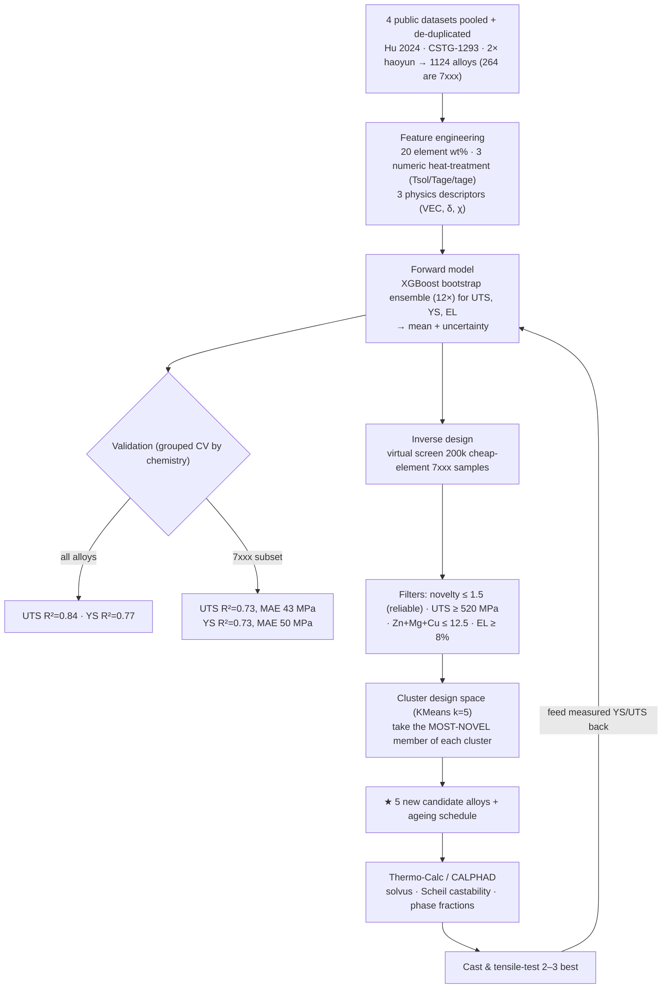

# ML-Driven Design of New 7xxx Aluminium Alloys

An end-to-end, reproducible machine-learning pipeline that learns how composition **and
heat-treatment** control the strength of wrought aluminium alloys, then **inverse-designs new
7xxx (Al-Zn-Mg-Cu) compositions** using only **cheap, common foundry elements** (no Sc, Zr, Ti
or other rare/expensive additions).

The current objective is **discovery**: find *genuinely new* alloys (distinct from existing 7xxx)
with **good — not necessarily peak — strength**, that are reliable enough to take into
**Thermo-Calc (CALPHAD)** and then **cast and mechanically test**, feeding results back to
retrain the model (active learning).

---

## 🔬 Headline result — 5 NEW candidates (Zn, Mg, Cu, Mn, Cr only)

Novelty-prioritised: each is as **distinct from known 7xxx as the reliability cap allows**
(novelty = 1.5, ≈ the 95th-percentile gap in real data) while clearing a **520 MPa strength
floor**. From a **4-dataset pooled model** (1124 alloys, 7xxx UTS R² = 0.73). Machine-readable:
[`data/candidates_final.csv`](data/candidates_final.csv) / [`.xlsx`](data/candidates_final.xlsx).

| # | Al | Zn | Mg | Cu | Mn | Cr | Heat treatment | UTS | YS | EL % | Novelty | Character |
|---|----|----|----|----|----|----|----------------|:---:|:--:|:----:|:-------:|-----------|
| 1 | 87.3 | 6.9 | 3.0 | 2.2 | 0.24 | 0.09 | SHT 495 °C → WQ → age 127 °C / 44 h | **597** | 536 | 11 | 1.5 | High-Mg/Cu — strongest of the new set |
| 2 | 88.3 | 8.3 | 1.4 | 1.5 | 0.20 | 0.02 | SHT 493 °C → WQ → age 109 °C / 16 h | 557 | 467 | **17** | 1.5 | High-Zn lean-Mg — most ductile |
| 3 | 90.8 | 5.5 | 2.5 | 0.5 | 0.16 | 0.33 | SHT 461 °C → WQ → age 104 °C / 59 h | 537 | 469 | 10 | 1.5 | Lean, lean-Cu, high-Cr |
| 4 | 90.7 | 5.2 | 1.9 | 1.5 | 0.41 | 0.08 | SHT 480 °C → WQ → age 96 °C / 20 h | 526 | 406 | 14 | 1.5 | Lean, high-Mn dispersoid |
| 5 | 88.9 | 6.0 | 3.1 | 1.8 | 0.03 | 0.00 | SHT 463 °C → WQ → age 96 °C / 20 h | 521 | 425 | 14 | 1.5 | High-Mg, Cr/Mn-free |

*Units: wt %; strength in MPa. SHT = solution heat treatment; WQ = water quench. Fe ≤ 0.15,
Si ≤ 0.10 fixed impurities. These deliberately trade peak strength for **distinctiveness** — they
explore genuinely new regions (high-Mg #1/#5, high-Zn-lean-Mg #2, high-Cr #3, high-Mn #4).*

> **Honest framing:** at novelty 1.5 these sit slightly further from the data than a max-strength
> pick, so treat predictions as **±45–50 MPa**. They are still *reliable enough* (inside the data's
> own P95 gap) to be strong Thermo-Calc candidates — not validated optima. A separate
> **max-strength** set (≈640 MPa, novelty ≈ 1.2) can be produced by raising `FLOOR` and ranking on
> strength instead — see [§5](#5-inverse-design--how-the-candidates-were-found).

---

## 🗺️ Process flow



---

## 1. Data

Four public datasets — each linking **composition → numeric heat-treatment → mechanical
properties** — pooled and de-duplicated into **1124 alloys** (264 are 7xxx).

| File | Source | Rows | Role |
|------|--------|-----:|------|
| `data/hu2024_dataset.xlsx` | Hu et al. 2024, *Comput. Mater. Sci.* 244:113204 | 1150 | Primary (numeric solution/ageing T & time) |
| `data/cstg_origin1293.xlsx` | GitHub `CSTG-bug/TheFinal` | 1292 | Age-hardenable augmentation |
| `data/haoyun_*.xlsx` | GitHub `haoyunlianlian744/Wrought-Aluminum-Alloys` | 524 / 320 | Augmentation |
| `data/bhat2023_al_data.csv` | Bhat, Barnard & Birbilis 2023 ([Mendeley, CC-BY-4.0](https://doi.org/10.17632/b6br4yk6r3.1)) | 1154 | Clean-licence corroborator |

Provenance & licences: [`data/DATA_SOURCES.md`](data/DATA_SOURCES.md). **Raw third-party datasets
are not redistributed here** (no redistribution licence) — download them with the commands there.

## 2. Features

- **Element wt %** (20 elements; Al = balance).
- **3 numeric heat-treatment** variables: solution temperature, ageing temperature, ageing time.
- **3 physics descriptors** from atomic fractions: valence-electron concentration (**VEC**), mean
  Pauling **electronegativity**, atomic **size-mismatch δ**.

## 3. Forward model

`XGBoost` (`n_estimators=600, max_depth=5, lr=0.03, subsample=0.8, colsample_bytree=0.8,
min_child_weight=3`); separate models for UTS, YS, EL. A **12-member bootstrap ensemble** per
target gives the prediction (mean) and uncertainty (std). Script: [`build_candidates.py`](build_candidates.py).

## 4. Performance — grouped cross-validation (honest test on unseen chemistries)

| Target | All alloys | **7xxx subset** |
|--------|:----------:|:---------------:|
| **UTS** | R² 0.84 · MAE 43 MPa | **R² 0.73 · MAE 43 MPa** |
| **YS**  | R² 0.77 · MAE 55 MPa | **R² 0.73 · MAE 50 MPa** |
| **EL**  | R² 0.30 | not reliable |

Validated by **grouping on chemistry** (no alloy in both train and test) — generalisation, not
memorisation. Pooling the four datasets lifted 7xxx UTS R² from 0.33 (single dataset) to **0.73**.
**Elongation remains unpredictable** and is *not* used as an objective.

## 5. Inverse design — how the candidates were found

[`build_candidates.py`](build_candidates.py) runs a **virtual screen** of 200 000 random
cheap-element 7xxx compositions × ageing schedules within wide, data-backed bounds
(Zn 4–9.5, Mg 1–3.2, Cu 0–2.8, Mn 0–0.5, Cr 0–0.35 wt %; Tsol 455–495 °C, Tage 95–160 °C,
tage 6–60 h), each scored by the ensemble, then filtered and selected:

- **Reliability cap:** `novelty ≤ 1.5` (≈ the 95th-percentile nearest-neighbour gap *within* real
  7xxx data) — new, but not blind extrapolation.
- **Strength floor:** `UTS ≥ 520 MPa` (good, not peak — discovery-first).
- **Manufacturability:** Zn + Mg + Cu ≤ 12.5 wt %; EL ≥ 8 %.
- **Selection:** cluster the survivors (KMeans, k = 5) and take the **most-novel** member of each
  cluster → 5 distinct *new* alloys.

> To instead get a **max-strength** set, set `FLOOR` high (or rank by `UTS − σ`); that returns
> tuned 7075/7050/7150-type alloys at ≈640 MPa, novelty ≈ 1.2. An NSGA-II multi-objective variant
> lives in [`inverse_design_cheap.py`](inverse_design_cheap.py).

## 6. Novelty

**Novelty = minimum standardised distance** from a candidate to every real 7xxx alloy, in the
`[Zn, Mg, Cu, Mn, Cr + heat-treatment]` space (z-scored). Real-data nearest-neighbour gaps:
median 0.15, P90 1.32, P95 1.49. A cap of **1.5** therefore admits alloys as distinct as the most
isolated real alloys — genuinely new, yet still close enough that the model is trustworthy.

## 7. Limitations (read before casting)

1. **Predictions are hypotheses** — treat as **±45–50 MPa** at this novelty level.
2. **Model is blind to microstructure** — grain size, quench rate and **multi-stage ageing
   (RRA/T74)** are not represented.
3. **Castability not yet checked** — that is the Thermo-Calc step (Scheil freezing range); the
   long-ageing picks (#1, #3) and high-Mg picks should be checked for solvus/coarse phases.
4. **Strength is "good", not record** — peak cheap-7xxx strength (≈640) was traded for novelty by
   design, per the discovery goal.

## 8. Next steps

Thermo-Calc each candidate (solvus vs. solution T; Scheil castability; phase fractions at the
ageing temperature → confirm η′/MgZn₂), cut to the 2–3 most castable, **cast & tensile-test**,
then feed results back into the model.

---

## Repository structure

```
.
├── README.md
├── build_candidates.py        # ★ pooled model + virtual screen → data/candidates_final.csv
├── make_candidates_xlsx.py    # candidates_final.csv → .xlsx (Candidates + ReadMe sheets)
├── novelty_sweep.py           # strength-vs-novelty trade-off analysis
├── forward_model.py           # single-dataset forward model (baseline)
├── inverse_design.py          # NSGA-II, all elements allowed
├── inverse_design_cheap.py    # NSGA-II, cheap elements only
├── eda.py / poc.py            # dataset analysis + feasibility study
└── data/
    ├── DATA_SOURCES.md        # provenance, licences, re-download commands
    ├── COLUMNS.md             # column dictionary for candidates_final.csv
    ├── candidates_final.csv   # ★ 5 new candidates (novelty-prioritised)
    ├── candidates_final.xlsx  # ★ same, with Candidates + ReadMe sheets
    ├── candidates_cheap.csv   # earlier single-dataset cheap variant
    └── candidates.csv         # rare-element variant (Sc/Zr/Ti allowed)
```

## Reproduce

```bash
pip install pandas numpy scikit-learn xgboost pymoo scipy openpyxl
# download datasets per data/DATA_SOURCES.md, then:
python3 build_candidates.py        # prints CV metrics, writes data/candidates_final.csv
python3 make_candidates_xlsx.py    # writes data/candidates_final.xlsx
```

## References

- Hu et al. (2024) *Comput. Mater. Sci.* **244**, 113204.
- Bhat, Barnard & Birbilis (2023) Mendeley Data, DOI 10.17632/b6br4yk6r3.1.
- Li et al. (2020) *Commun. Mater.* **1**, 73 (ML-discovered 7xxx, UTS 952 MPa).
- Pfeiffer et al. (2022) *Sci. Data* **9**, 128 (original composition corpus).

---

*Built with Python (pandas, scikit-learn, XGBoost, pymoo). Predictions are computational
estimates requiring thermodynamic and experimental validation.*
