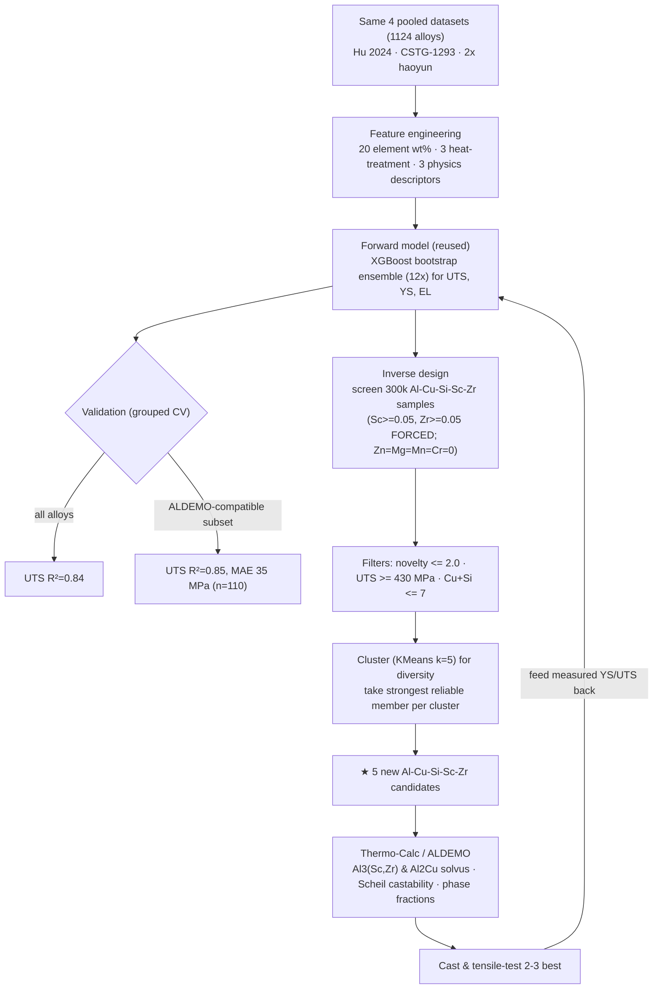

# ML Design of New Al-Cu-Sc-Zr Alloys — *for the Thermo-Calc ALDEMO database*

A parallel pipeline to the main 7xxx work ([`README.md`](README.md)), restricted to the **five
elements in Thermo-Calc's free ALDEMO demo database — Al, Cu, Si, Sc, Zr**. Everything from the
7xxx project is kept and untouched; this is a self-contained second track.

## Why this exists

ALDEMO is the small demo subset of the full TCAL aluminium database. **It contains no Zn and no
Mg.** Every 7xxx candidate in [`candidates_final.csv`](data/candidates_final.csv) is Al-**Zn-Mg**-Cu,
so **none of them can even be loaded into ALDEMO**. To design something this database *can*
thermodynamically validate, we switch alloy family:

- **Cu** → main strengthener via θ′ (Al₂Cu) precipitation — the **2xxx** mechanism.
- **Sc + Zr** → Al₃Sc / Al₃Zr / Al₃(Sc,Zr) L1₂ dispersoids → grain refinement, recrystallisation
  resistance, thermal stability, extra strength.
- **Si** → kept low (castability only).

This is a genuinely strong, **heat-resistant**, and (mostly) affordable family — and the division of
labour is clean: **ML predicts the Cu/θ′ strength, ALDEMO/Thermo-Calc predicts the Sc/Zr phases.**

---

## 🔬 Headline — 5 NEW ALDEMO-validatable candidates

From the **same 4-dataset pooled model** (1124 alloys), screened over the Al-Cu-Si-Sc-Zr space with
**Sc and Zr forced present** so every alloy genuinely uses the ALDEMO chemistry. Machine-readable:
[`data/candidates_aldemo.csv`](data/candidates_aldemo.csv) / [`.xlsx`](data/candidates_aldemo.xlsx).

| # | Al | Cu | Si | Sc | Zr | Heat treatment | UTS | YS | EL % | Novelty | Character |
|---|----|----|----|----|----|----------------|:---:|:--:|:----:|:-------:|-----------|
| 1 | 94.3 | 5.0 | 0.19 | 0.16 | 0.23 | SHT 521 °C → WQ → age 152 °C / 43 h | **454** | 356 | 11 | 1.92 | Balanced Sc+Zr — most novel |
| 2 | 93.5 | 6.0 | 0.04 | 0.14 | 0.18 | SHT 521 °C → WQ → age 151 °C / 33 h | 452 | 356 | 11 | 1.63 | High-Cu |
| 3 | 94.2 | 5.3 | 0.01 | 0.10 | 0.24 | SHT 522 °C → WQ → age 151 °C / 35 h | 451 | **361** | 11 | 1.16 | High-Zr, lean-Sc |
| 4 | 94.5 | 4.8 | 0.17 | **0.33** | 0.11 | SHT 523 °C → WQ → age 151 °C / 31 h | 448 | 357 | 11 | 1.80 | High-Sc — max Al₃Sc |
| 5 | 93.7 | 5.8 | 0.08 | 0.10 | 0.20 | SHT 521 °C → WQ → age 151 °C / 24 h | 446 | 353 | 11 | 1.09 | Closest to proven Al-Cu-Zr — **cheapest** |

*Units: wt %; strength MPa. SHT = solution heat treatment; WQ = water quench. Fe = 0.15 fixed
impurity. Benchmarks (ALDEMO-castable): 2219-T87 ≈ 475 MPa; real Al-Cu-Zr in our data up to 510.*

> **Honest framing.** Predictions here are **conservative** — the model's strength ceiling in this
> corner is only ≈456 MPa, yet real Al-Cu-Zr already reaches 475–510, so true strength with good
> processing is likely **higher**, not lower. Treat numbers as **±35 MPa** (the ALDEMO-subset
> grouped-CV error). The model captures Cu/θ′ strength well but **under-credits Al₃(Sc,Zr)** —
> that benefit shows up in Thermo-Calc, not in the UTS column.

---

## 🗺️ Process flow



---

## 1–3. Data · features · model

**Identical to the 7xxx pipeline** (see [`README.md`](README.md) §1–3): the same 4 pooled, de-duplicated
datasets (1124 alloys), the same features (20 element wt % + 3 numeric heat-treatment + VEC/χ/δ
physics descriptors), and the same 12-member XGBoost bootstrap ensemble. **No retraining bias** —
we simply restrict the *inverse-design search* to the ALDEMO element set. Script:
[`build_candidates_aldemo.py`](build_candidates_aldemo.py).

## 4. Performance — does the model hold *in this chemistry*?

Grouped cross-validation (no alloy in both train and test), reported **specifically on the
ALDEMO-compatible alloys** (Zn/Mg/Mn/Cr ≈ 0):

| Target | All alloys | **ALDEMO-compatible subset** |
|--------|:----------:|:----------------------------:|
| **UTS** | R² 0.84 · MAE 43 | **R² 0.85 · MAE 35 MPa** (n=110) |
| **YS**  | R² 0.77 · MAE 55 | R² 0.55 · MAE 40 MPa (n=99) |
| **EL**  | R² 0.30 | R² 0.40 — not reliable |

UTS is **as trustworthy here as for 7xxx**. The caveat is *Sc/Zr specifically*: the data has many
Al-Cu and Al-Cu-Zr points but few Al-Cu-**Sc**-Zr, so the model is conservative about the Sc bonus
(it cannot over-promise it).

## 5. Inverse design — how the candidates were found

[`build_candidates_aldemo.py`](build_candidates_aldemo.py) virtual-screens **300 000** random
Al-Cu-Si-Sc-Zr compositions × ageing schedules within data-backed bounds
(Cu 2–6.5, Si 0–0.8, **Sc 0.05–0.4, Zr 0.05–0.25** — both forced present; Tsol 520–545 °C,
Tage 150–200 °C, tage 8–48 h; Zn = Mg = Mn = Cr = 0), each scored by the ensemble, then:

- **Strength floor** `UTS ≥ 430 MPa` (good for an ALDEMO-castable Al-Cu alloy).
- **Reliability cap** `novelty ≤ 2.0`.
- **Selection:** cluster survivors (KMeans, k = 5) for compositional **diversity**, take the
  **strongest reliable** member (`UTS − σ`) of each cluster → 5 distinct alloys spanning
  high-Cu, high-Zr, high-Sc and balanced regions.

## 6. Novelty

**Novelty = minimum standardised distance** to the nearest real **Cu-bearing ALDEMO-compatible**
alloy (32 in our data), in `[Cu, Si, Sc, Zr]` space. This corner is sparse (real nearest-neighbour
gaps P90 ≈ 0.47), so novelty 1–2 means the candidate is **genuinely new** — and, by the same token,
a real extrapolation that **must** be checked in Thermo-Calc and casting.

## 7. What to check in Thermo-Calc (ALDEMO)

1. **Al₃(Sc,Zr) solvus** — confirm the dispersoids are stable above your homogenisation T (≈350–450 °C)
   but check how much survives the ≈521 °C solutionising step (this is the key Sc/Zr question).
2. **Al₂Cu (θ) solvus** — confirm Cu fully dissolves at `Tsol`; set the real solutionising T below it.
3. **Scheil solidification** — freezing range → hot-tearing risk (high-Cu #2/#5 most at risk).
4. **Phase fractions at `Tage`** — confirm θ′/θ available to strengthen.

## 8. Limitations

1. **Predictions are conservative hypotheses** (±35 MPa) — and likely *under*-state Sc/Zr strength.
2. **Single-step ageing only** — real Al-Cu-Sc-Zr benefits from a separate high-T step for
   Al₃(Sc,Zr); the model sees one `Tage`.
3. **Sc cost** — Sc ≈ $3000/kg; **Zr is cheap**. Candidate #5 (lean Sc) is the budget pick.
4. **Microstructure unseen** — grain size, quench rate, cold-work (2xxx often -T8) not represented.

## Reproduce

```bash
pip install pandas numpy scikit-learn xgboost scipy openpyxl
# download datasets per data/DATA_SOURCES.md, then:
python3 build_candidates_aldemo.py        # prints CV metrics, writes data/candidates_aldemo.csv
python3 make_candidates_aldemo_xlsx.py    # writes data/candidates_aldemo.xlsx
```

## Files (this track)

```
build_candidates_aldemo.py        # ★ pooled model + Al-Cu-Si-Sc-Zr screen -> candidates_aldemo.csv
make_candidates_aldemo_xlsx.py    # candidates_aldemo.csv -> .xlsx (Candidates + ReadMe sheets)
data/candidates_aldemo.csv        # ★ 5 new ALDEMO-validatable candidates
data/candidates_aldemo.xlsx       # ★ same, with Candidates + ReadMe sheets
data/COLUMNS_ALDEMO.md            # column dictionary for the above
```

---

*Built with Python (pandas, scikit-learn, XGBoost). Predictions are computational estimates
requiring thermodynamic (Thermo-Calc/ALDEMO) and experimental validation.*
